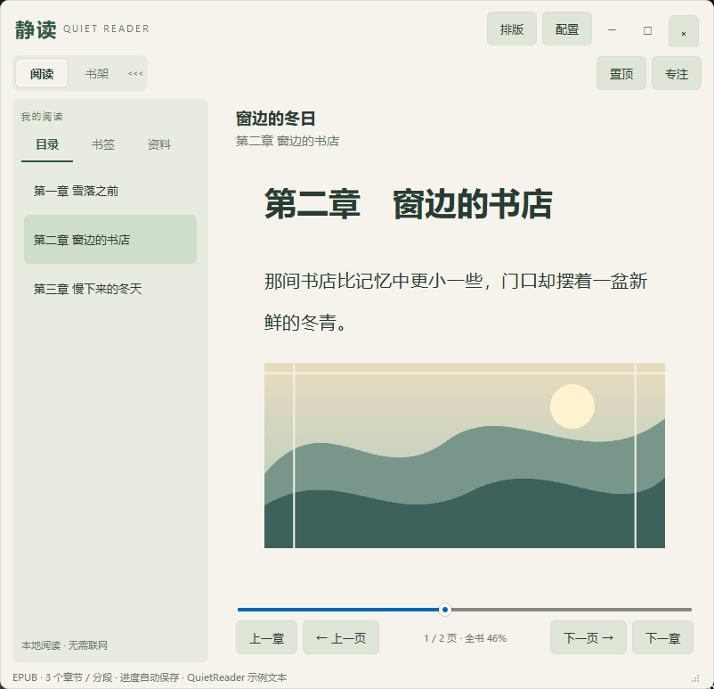
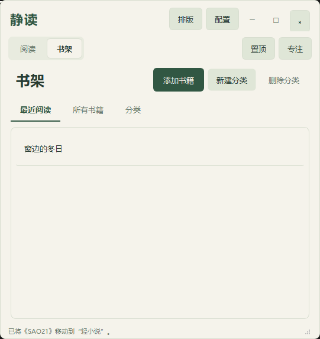
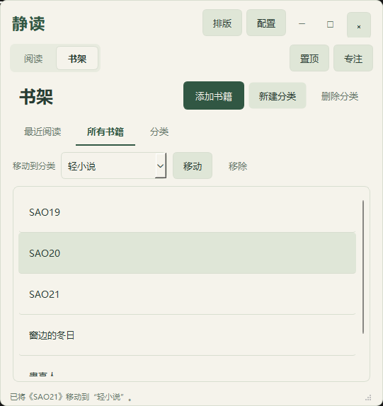
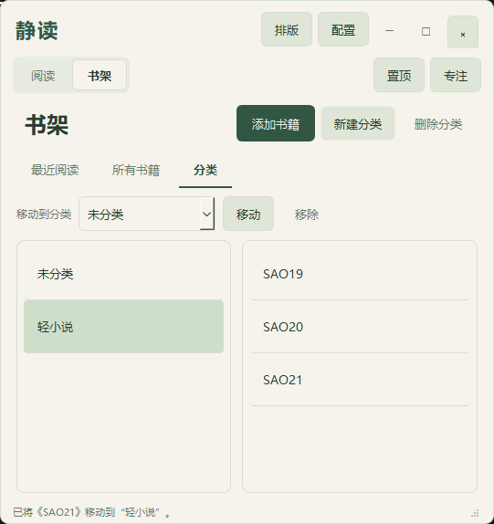
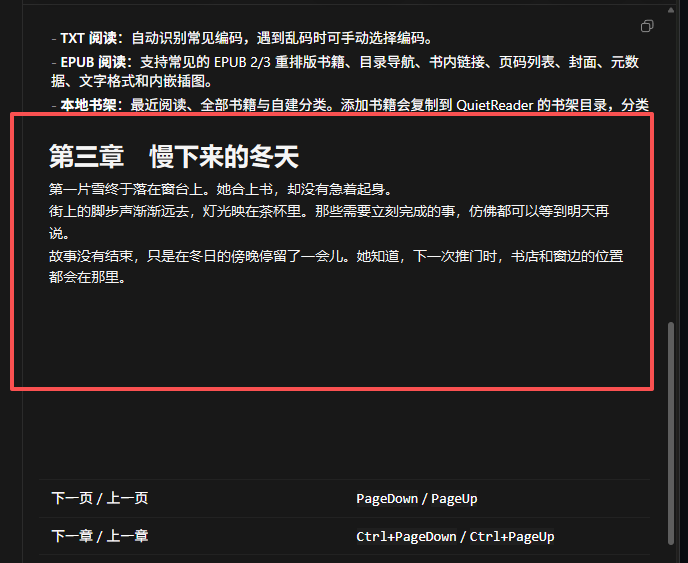
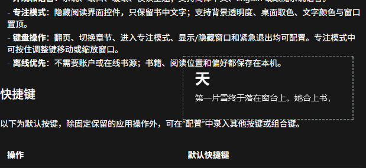
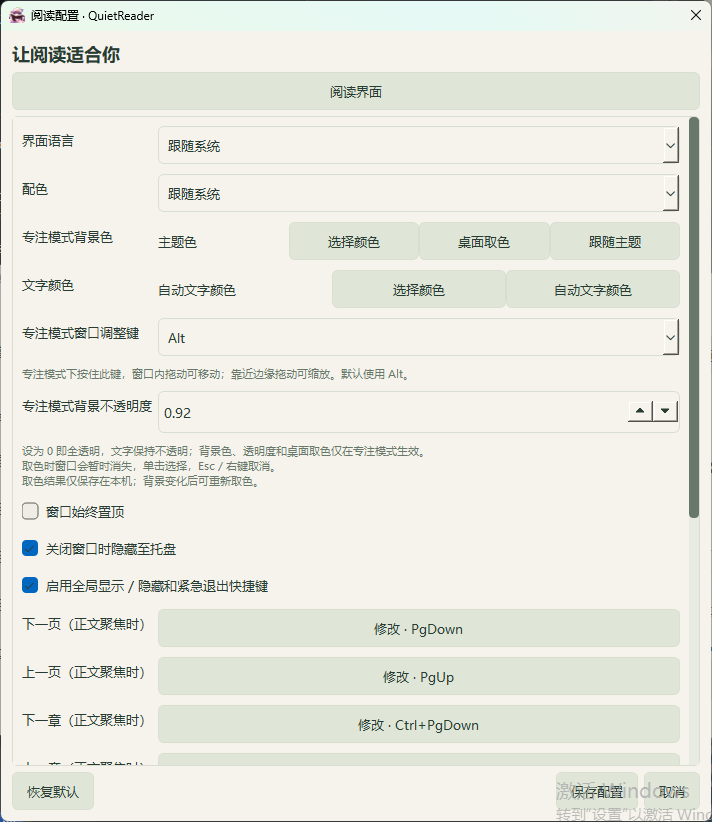
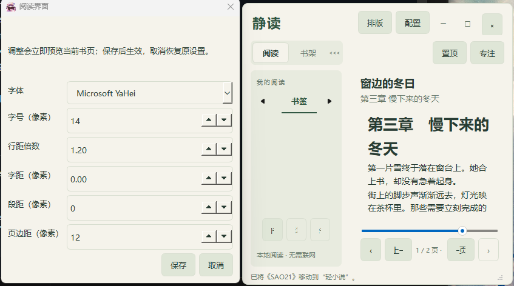

# QuietReader · 静读 — A Quiet Library

[简体中文](README.md) · [English](README.en.md)

<p align="center"></p>

QuietReader is an offline-first desktop reader for Windows, built with Python and PySide6. It reads local TXT and EPUB books and includes a bookshelf, navigation, bookmarks, live layout controls, and a distraction-free Focus mode. Books and reading progress stay on your computer.

## Screenshots



**Reading view:** Contents navigation, chapter text, and an embedded EPUB illustration.

<details>
<summary>Bookshelf: recent, all books, and categories</summary>







</details>

<details>
<summary>Focus mode: matching the desktop and adjusting the window</summary>





</details>

<details>
<summary>Configuration and live layout preview</summary>





</details>

## Features

- **TXT reading** with automatic detection for common encodings and manual encoding selection when text looks garbled.
- **EPUB reading** for common EPUB 2/3 reflowable books, including navigation, internal links, page lists, covers, metadata, text formatting, and embedded illustrations.
- **Local bookshelf** with recent books, all books, and custom categories. Adding a book copies it into the QuietReader library; moving it to a category moves that managed copy and leaves the original file untouched.
- **Reading tools** including a table of contents, bookmarks and notes, book information, saved positions, and a collapsible sidebar.
- **Live typography controls** for font size, font family, line height, letter spacing, paragraph spacing, and page padding.
- **Themes and languages** with system, paper, sepia, and night themes, plus Simplified Chinese, English, or the system language.
- **Focus mode** hides reader controls and shows the book text, with configurable background opacity, desktop color sampling, text color, and always-on-top behavior. Hold the adjustment key to move or resize the window; only a fully transparent background is temporarily raised to 1% for mouse input, while other opacity levels remain unchanged.
- **Keyboard controls** for paging, chapter navigation, Focus mode, window visibility, and emergency exit. Hold the configured adjustment key to move or resize the window in Focus mode.
- **Offline by design**: no account or online book source is required; books, positions, and preferences stay local.

## Keyboard shortcuts

These are the defaults. Shortcuts can be changed in Configuration, except for a small set reserved for application actions.

| Action | Default |
| --- | --- |
| Next / previous page | `PageDown` / `PageUp` |
| Next / previous chapter | `Ctrl+PageDown` / `Ctrl+PageUp` |
| Enter or exit Focus mode | `F10` or `Esc` |
| Toggle Focus mode opacity (0% / 100%) | `F9` |
| Add books / Configuration | `Ctrl+O` / `Ctrl+,` |
| Show / hide the window | `Ctrl+Alt+R` |
| Emergency exit | `Ctrl+Alt+Q` |

Global shortcuts for window visibility and emergency exit can be enabled in Configuration so they work while the window is hidden or unfocused. The default Focus mode window adjustment key is `Alt`.

## Download and run

Windows portable packages, when published, are available on [GitHub Releases](https://github.com/Nore07/Quiet-Reader/releases). Keep all files in the extracted directory when running a portable package.

### Run from source

Python 3.12 or newer is required. From the repository root in PowerShell:

```powershell
py -3.12 -m venv .venv
.\.venv\Scripts\python.exe -m pip install -r requirements.txt
.\.venv\Scripts\python.exe run.py
```

To open a local book directly:

```powershell
.\.venv\Scripts\python.exe run.py "D:\Books\sample.epub"
```

### Build a Windows portable package

```powershell
.\.venv\Scripts\python.exe -m pip install ".[build]"
.\scripts\build.ps1
```

The package is written to `dist\QuietReader\`; keep the whole directory. The build script generates a multi-size ICO from the app PNG and bundles the PNG for runtime use.

## Formats and local data

QuietReader currently targets common TXT and unencrypted, reflowable EPUB files. DRM-protected resources, fixed-layout EPUB, active content, and external network resources are not supported. Complex publisher styles may affect layout.

Preferences, reading positions, bookmarks, and bookshelf copies are saved in the Windows local application data directory by default. Use `--data-dir <directory>` to select a separate data location, including for portable use or separate libraries.

## Contributing

Report bugs and suggest improvements through [GitHub Issues](https://github.com/Nore07/Quiet-Reader/issues). Pull Requests are welcome.

## License

QuietReader source code is licensed under the [Apache License 2.0](LICENSE) (SPDX: `Apache-2.0`). See [`docs/third-party.md`](docs/third-party.md) for third-party dependency and distribution notes.
