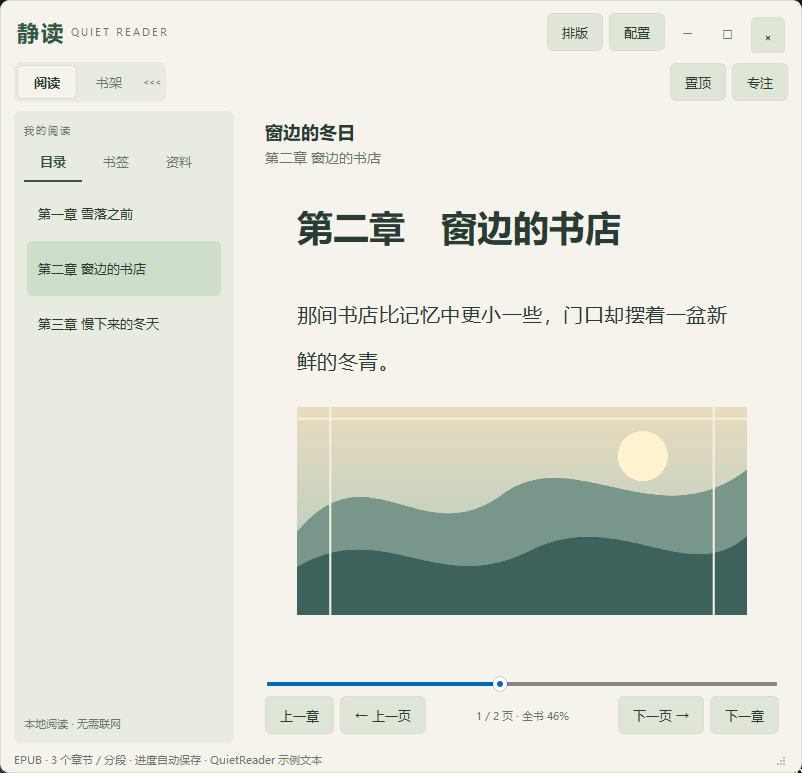
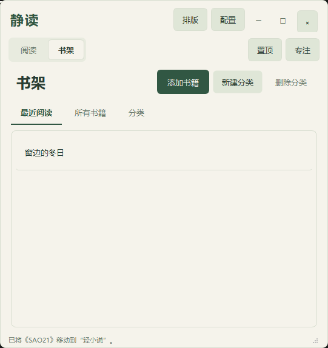
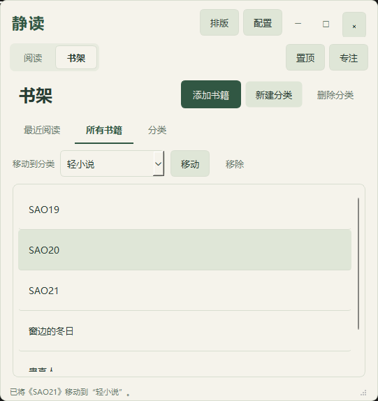
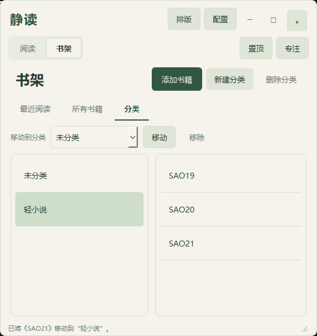
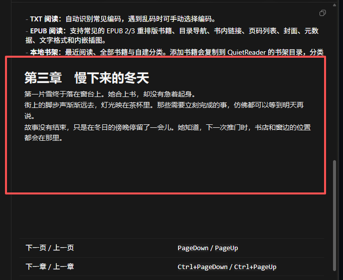
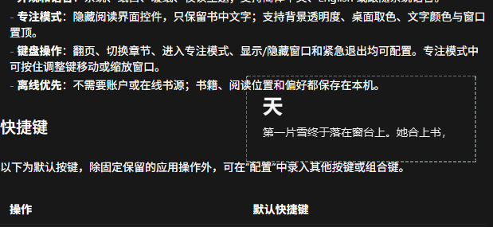
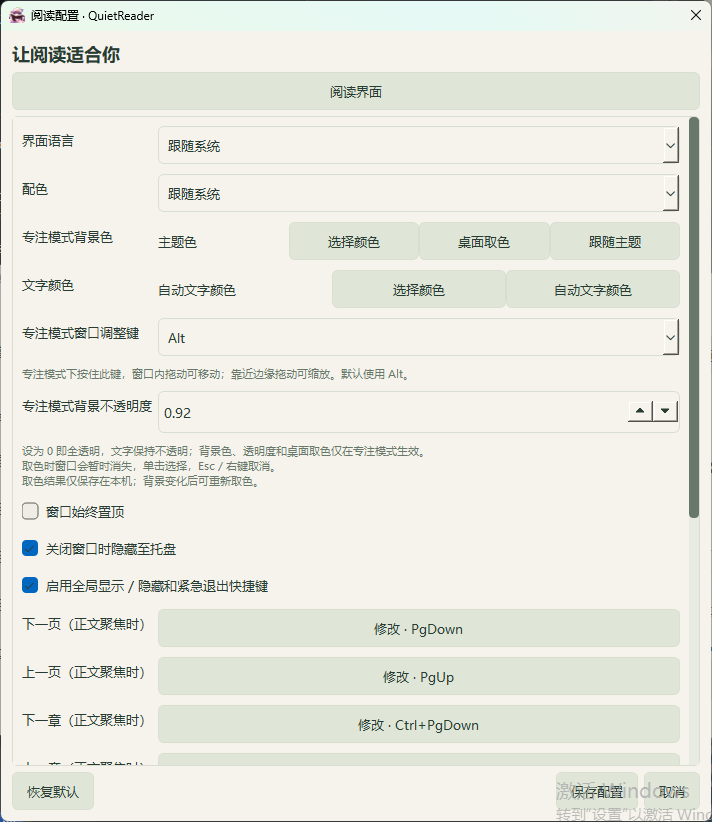
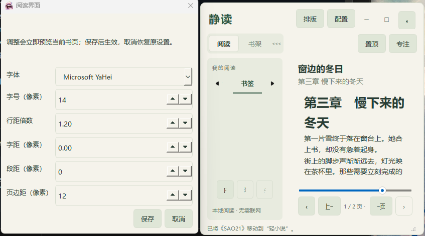

# QuietReader · 静读 —— 安静的大图书馆

[简体中文](README.md) · [English](README.en.md)

<p align="center"></p>

QuietReader 是一款面向 Windows 的离线本地阅读器，使用 Python 与 PySide6 构建。它支持 TXT 和 EPUB，提供书架、目录、书签、排版调节和专注阅读；书籍与阅读进度保存在本机。

## 界面预览



**阅读界面：** 展示目录、章节阅读和 EPUB 内嵌插图。

<details>
<summary>书架：最近阅读、所有书籍、分类</summary>







</details>

<details>
<summary>专注模式：背景融合与窗口调整</summary>





</details>

<details>
<summary>配置与实时排版</summary>





</details>

## 功能

- **TXT 阅读**：自动识别常见编码，遇到乱码时可手动选择编码。
- **EPUB 阅读**：支持常见的 EPUB 2/3 重排版书籍、目录导航、书内链接、页码列表、封面、元数据、文字格式和内嵌插图。
- **本地书架**：最近阅读、全部书籍与自建分类。添加书籍会复制到 QuietReader 的书架目录，分类时会移动书架内的副本，原始文件不受影响。
- **阅读辅助**：目录、书签与笔记、书籍资料、阅读位置恢复、可折叠侧栏。
- **实时排版**：字号、字体、行距、字距、段距和页边距可在阅读界面中即时预览。
- **外观和语言**：系统、纸白、暖纸、夜读主题；支持简体中文、English 或跟随系统语言。
- **专注模式**：隐藏阅读界面控件，只保留书中文字；支持背景透明度、桌面取色、文字颜色与窗口置顶。按住调整键可移动或缩放窗口；只有背景为 0% 时才临时提高到 1% 以接收鼠标操作，已有的非零透明度保持不变。
- **键盘操作**：翻页、切换章节、进入专注模式、显示/隐藏窗口和紧急退出均可配置。专注模式中可按住调整键移动或缩放窗口。
- **离线优先**：不需要账户或在线书源；书籍、阅读位置和偏好都保存在本机。

## 快捷键

以下为默认按键，除固定保留的应用操作外，可在“配置”中录入其他按键或组合键。

| 操作 | 默认快捷键 |
| --- | --- |
| 下一页 / 上一页 | `PageDown` / `PageUp` |
| 下一章 / 上一章 | `Ctrl+PageDown` / `Ctrl+PageUp` |
| 进入或退出专注模式 | `F10` 或 `Esc` |
| 专注模式透明度切换（0% / 100%） | `F9` |
| 添加书籍 / 配置 | `Ctrl+O` / `Ctrl+,` |
| 显示 / 隐藏窗口 | `Ctrl+Alt+R` |
| 紧急退出 | `Ctrl+Alt+Q` |

显示/隐藏和紧急退出可在配置中启用全局快捷键，以便窗口隐藏或未聚焦时也能触发。专注模式的窗口调整键默认为 `Alt`。

## 获取与运行

Windows 便携版（如有发布）可在 [GitHub Releases](https://github.com/Nore07/Quiet-Reader/releases) 获取。运行便携版时请保留解压目录中的全部文件。

### 从源码运行

需要 Python 3.12 或更新版本。在仓库根目录运行 PowerShell 命令：

```powershell
py -3.12 -m venv .venv
.\.venv\Scripts\python.exe -m pip install -r requirements.txt
.\.venv\Scripts\python.exe run.py
```

也可直接打开一本本地书籍：

```powershell
.\.venv\Scripts\python.exe run.py "D:\Books\sample.epub"
```

### 构建 Windows 便携版

```powershell
.\.venv\Scripts\python.exe -m pip install ".[build]"
.\scripts\build.ps1
```

构建产物位于 `dist\QuietReader\`，需保留整个目录。`build.ps1` 会从应用 PNG 图标生成多尺寸 ICO，并将 PNG 作为运行时资源打包。

## 格式与数据

目前面向常见的 TXT 与未加密、重排版 EPUB。DRM 加密资源、固定版式 EPUB、活动内容和外部网络资源不在支持范围内；不同 EPUB 的样式复杂度可能影响排版效果。

默认情况下，配置、阅读位置、书签和书架副本写入 Windows 本地应用数据目录。可使用 `--data-dir <目录>` 指定独立的数据位置；这也适用于便携使用或多个独立书库。

## 参与项目

欢迎通过 [GitHub Issues](https://github.com/Nore07/Quiet-Reader/issues) 报告问题或提出改进建议，也欢迎提交 Pull Request。

## 许可

QuietReader 项目代码采用 [Apache License 2.0](LICENSE)（SPDX：`Apache-2.0`）。第三方依赖及其分发说明见 [`docs/third-party.md`](docs/third-party.md)。
